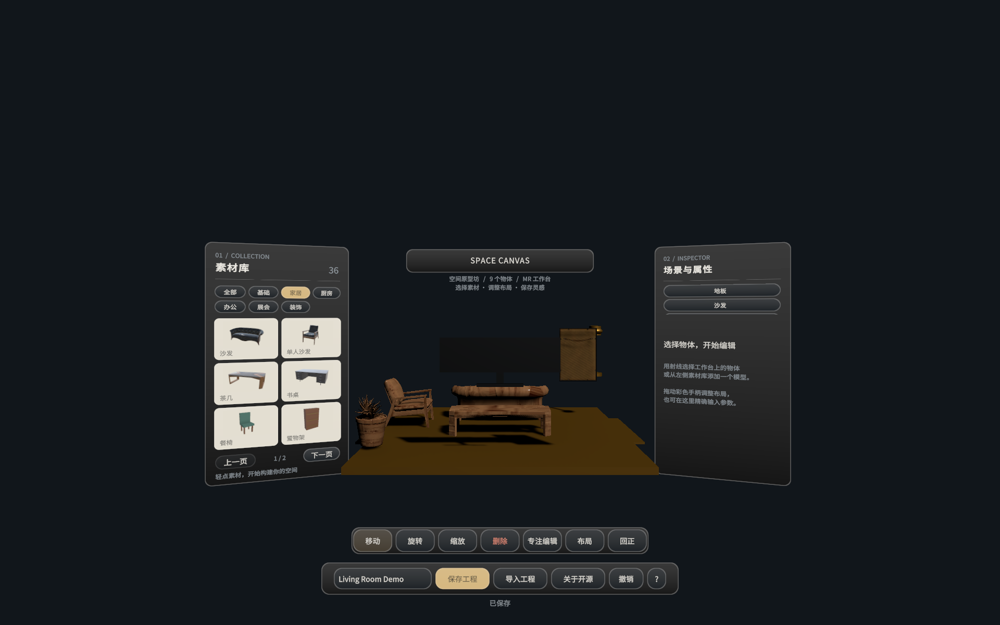

# SpaceCanvas 空间原型坊


**在真实空间中搭建布局，将灵感保存为可编辑、可共享、可导入 Unity 的开放工程。**

SpaceCanvas 是面向 PICO Swan 的 MR 空间原型工具。用户可在透视背景下放置家具和基础模型，调整位置、旋转、缩放与外观，并通过 `.spacecanvas` JSON 将头显中的布局带回 Unity 继续开发。

当前版本 **0.3.2**，Android 包名 **`com.spacecanvas.prototype`**。当前运行入口采用 **Full Space MR / OpenXR**；仓库保留早期空间窗口适配代码，不能将其理解为当前 APK 已完成 Shared Space 系统原生多窗口验收。



*以上为 Unity 编辑器预览，不是头显透视画面的截图。*

## 功能

- 36 个素材 ID，包含基础体、家居、办公、展会及装饰分类，部分家具接入 CC0 真实模型与贴图。
- 手柄/手势射线交互，半透明放置预览，独立确认放置，移动、旋转、缩放手柄与数值编辑。
- 外观配色、复制删除、层级与分组、20 步撤销，以及整次工程导入撤销。
- 开放 JSON 工程导入导出、Android 沙盒保存、存档缩略图、时间和物体数量、版本预览确认。
- 客厅、展位、工位三套示例，首次使用教学和工程恢复相关功能。
- Unity 菜单 **导入PICO工程 → 导入工程文件**，从已连接头显读取存档并恢复布局。
- 独立编辑器导入脚本，不依赖 SpaceCanvas 运行时即可读取工程数据。
- Unity 6 TMP 着色器兼容校验、面板轮廓抗锯齿和 MR UI 可读性修复。

## 获取与打开

1. 克隆仓库：`git clone https://github.com/ultimetamr/SpaceCanvas.git`。
2. 使用 Unity Hub 安装 **Unity 6000.6.8f1**，勾选 Android Build Support、SDK/NDK 和 OpenJDK。
3. **首次打开 Unity 前**，按照 [依赖恢复指南](docs/SETUP.md) 放入已合法获取的 PICO SDK 6.1.1 与 SpatialAdapter 6.1.0，运行恢复脚本完成本项目的 Unity 6 兼容处理。这两项 SDK 的本地许可证禁止未经书面许可再分发，因此不包含在公开库。
4. 用 Unity Hub 打开仓库，等待 UPM 恢复依赖。Newtonsoft.Json 由官方 UPM 包 `com.unity.nuget.newtonsoft-json` 提供。
5. 打开 `Assets/Scenes/SpaceCanvas_FullSpaceMR.unity`，切换到 Android。使用已有场景构建，保留场景中编辑后的模型布局。

本仓库提交自有源码、Unity 场景、预制体、材质、模型/贴图、字体与授权文件、示例、工程设置、依赖清单和可再分发的嵌入包。Library、构建缓存、APK、设备私人存档、用户配置和签名密钥不入库。第三方组件各自保留原许可，详见 [第三方声明](THIRD_PARTY_NOTICES.md)。

## 工程结构

```text
Assets/
  Scenes/SpaceCanvas_FullSpaceMR.unity    # 当前 MR 启动场景
  Scripts/ProjectIO/                     # 数据、导入导出、编辑、UI、交互源码
    Editor/                             # 独立导入器、构建工具、编辑器测试
    Presentation/                       # 面板视觉与着色器
    Spatial/                            # 空间 SDK 适配
    Tests/                              # 核心 EditMode 测试
    XR/                                 # Full Space/OpenXR 输入与呈现
  Resources/                            # 运行时模型、材质、字体等
  SpaceCanvasArt/                        # 模型原文件、贴图及来源记录
  StreamingAssets/
    SpaceCanvasDocs/                     # 格式、接入、迁移和验收文档
    ExampleProjects/                     # 三个可导入 JSON 示例
Packages/                               # manifest、lock、可再分发嵌入依赖
ProjectSettings/                        # Unity/Android/XR 工程配置
Tools/Restore-PicoDependencies.ps1       # 本地 SDK 恢复与兼容修复
docs/                                   # 开源接入说明和作品信息
```

## 头显工程带回 Unity

在头显中保存工程，USB 连接电脑并允许调试，然后在 Unity 点击 **导入PICO工程 → 导入工程文件**。核对项目时间、数量和预览，确认后导入。文件保存在应用沙盒 `Application.persistentDataPath/Projects/`。

第三方开发者也可以只复制 `Assets/Scripts/ProjectIO/Editor/SpaceCanvasEditorImporter.cs` 到其他 Unity 工程的 `Assets/Editor/`，读取 `.spacecanvas` 文件。脱离本工程时，需自行提供同一 assetId 的模型才能还原相同外观；没有模型会使用占位体。脚本自带 DTO，使用 Unity 内置 JsonUtility；本项目运行时采用 Newtonsoft.Json。

- [开放工程格式规范](Assets/StreamingAssets/SpaceCanvasDocs/SpaceCanvas工程格式规范v1.0.md)
- [从头显导入 Unity](Assets/StreamingAssets/SpaceCanvasDocs/从头显导入Unity.md)
- [导入再打包一致性](Assets/StreamingAssets/SpaceCanvasDocs/PICO导入Unity再打包一致性.md)
- [真实素材来源与授权](Assets/StreamingAssets/SpaceCanvasDocs/真实家具素材来源与接入说明.md)

## 构建与测试

恢复依赖后，在 Unity 的 Build Profiles 中选 Android 并构建当前启动场景。也可使用以下命令；`<Unity.exe>` 替换为本机安装路径，命令中的 `.` 为当前仓库目录。

```powershell
& '<Unity.exe>' -batchmode -quit -projectPath . -executeMethod SpaceCanvas.ProjectIO.Editor.XR.SpaceCanvasFullSpaceBuilder.BuildExistingAndroid -logFile build.log -job-worker-count 4
```

不要调用重建场景入口来代替现有场景构建，否则会重新生成默认布局。详细说明见 [SETUP.md](docs/SETUP.md)。测试通过 Unity Test Runner 的 EditMode 页运行，或执行：

```powershell
& '<Unity.exe>' -batchmode -projectPath . -runTests -testPlatform EditMode -assemblyNames 'SpaceCanvas.ProjectIO.Tests;SpaceCanvas.ProjectIO.XR.Tests;SpaceCanvas.ProjectIO.Editor.Tests' -testResults test-results.xml -logFile tests.log
```

截至 2026-11-07，当前本机回归记录为 **136 项通过、0 失败、0 跳过**，Android APK 已构建并在 Swan 测试。用户确认文字与面板边缘明显改善、按钮点击正常。记录见 [验证摘要](docs/VALIDATION.md)；这不代表已完成所有设备、眼动或性能基准验收。

## 开源与二次开发

SpaceCanvas 自有代码、格式文档、示例 JSON 和原创原型资源采用 [MIT License](LICENSE)，允许修改与二次开发。PICO SDK、Unity 资源、开源依赖、字体和 CC0 模型按其各自许可证使用，不适用本项目的重新授权。

作品介绍与可填写的提交资料见 [作品信息](docs/APP_METADATA.md)，版本变化见 [CHANGELOG.md](CHANGELOG.md)。
